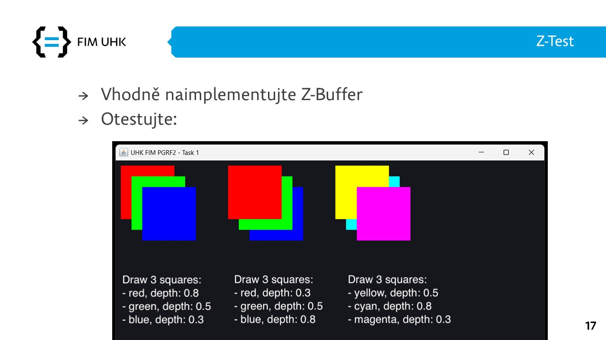

# Repository for ut13-c04

### TODO 2

### Progress checklist

- [ ] Complete triangle rasterizer
- [ ] Triangles have passed the visibility test
- [ ] (Additional) Viewport transformation
- [ ] (Additional) Vertex implementation
- [ ] (Additional) Complete line rasterizer _(for wireframe model)_

Your task is to draw two triangles with different depths at their vertices. Correctly interpolate the individual edges and fill in the area of the triangle.

Use these two triangles to verify correct depth interpolation:

```java
// first triangle
Point3D t1a = new Point3D(0., ((double) canvas.getHeight() /2) - 1, 0.5);
Point3D t1b = new Point3D(((double) canvas.getWidth() /2)-1, 0., 0.5);
Point3D t1c = new Point3D(canvas.getWidth() - 1, canvas.getHeight() - 1, 0.5);

// second triangle
Point3D t2a = new Point3D(canvas.getWidth()- 1, ((double) canvas.getHeight() /2) - 1, 0.8);
Point3D t2b = new Point3D(((double) canvas.getWidth() /2)-1, canvas.getHeight() - 1, 0.8);
Point3D t2c = new Point3D(0., 0., 0.1);
```

_Additionally, you can create a viewport transformation, but it is necessary to enter the coordinates of the triangles in NDC coordinates._

_Also you can start implementing a vertex that will carry all the attributes._

### Homework


## TODO 1

### Progress checklist

- [ ] Z-Buffer
- [ ] Passed visibility test

Two types of buffers should be created in this repository:
- **ColorBuffer** for storing color information about the canvas
- **DepthBuffer** for storing depth information about the canvas

We work with both buffers in the VisibilityBuffer class, which tests and updates _ImageBuffer_ based on the depth from _DepthBuffer_.

Furthermore, a test class called ```ZBufferTest.java``` was created, which contains a method for drawing squares and a static method for creating them.

### Homework


