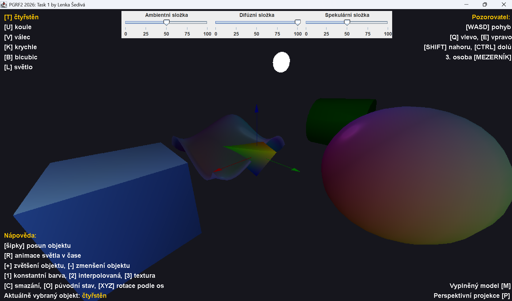

# Z-BUFFER

#### Semestrální projekt do předmětu Počítačová grafika 2 implementující 3D scénu s vlastním SW rendererem, Z-bufferem a Phongovým osvětlovacím modelem.



Celé vykreslování probíhá na CPU v čisté Javě (Swing slouží jen k zobrazení výsledného obrázku a k ovládání). Nepoužívá se OpenGL ani žádná jiná grafická knihovna. Transformace, ořezání, rasterizace, Z-test, interpolace i stínování jsou implementované v projektu.

---

## Funkce

- **Vlastní renderovací pipeline**: model → view → projekce (MVP), rychlé ořezání celého tělesa mimo zobrazovací objem, ořezání trojúhelníků i úseček podle near roviny (`clipZ`, `clipLineZ`), dehomogenizace a transformace do okna
- **Z-buffer**: test hloubky pro každý pixel (`Visibility.setPixelWithZTest`), hloubka v intervalu ⟨0, 1⟩, menší hodnota = blíž ke kameře
- **Rasterizace trojúhelníků** pomocí hranových funkcí a barycentrických souřadnic, **úseček** Bresenhamovým algoritmem
- **Perspektivně korektní interpolace** texturovacích souřadnic (interpolace `uv/w` a `1/w`)
- **Topologie**: `LINE_LIST`, `TRIANGLE_LIST`, `TRIANGLE_STRIP`
- **Tělesa**: čtyřstěn, koule, válec (včetně vyplněných podstav), krychle, bikubická Bézierova plocha, osy XYZ se šipkami a koule, která představuje světlo
- **Shadery** (fragment shadery):
  - konstantní barva
  - interpolovaná barva (Gouraudovo stínování)
  - textura (každé těleso má svou: tráva z Minecraftu na krychli, překližka na válci a čtyřstěnu, UV mřížka na kouli a bikubické ploše)
  - **Phongův osvětlovací model** s bodovým světlem, který se kombinuje s kterýmkoliv z předchozích shaderů (ambientní, difúzní a spekulární složka a útlum se vzdáleností)
- **Animace světla**: světlo obíhá kolem osy Z
- **Perspektivní / ortogonální projekce**
- **Vyplněný / drátový model**
- **Kamera** z pohledu 1. nebo 3. osoby, ovládání klávesnicí i myší
- **Transformace vybraného objektu**: posun, rotace, změna velikosti kolem středu
- **Změna velikosti okna**: barevný buffer i Z-buffer se přizpůsobí nové velikosti okna

---

## Požadavky a spuštění

- **JDK 25 nebo novější**: aplikace sama potřebuje JDK 22+ (`List.getFirst()` a nepojmenované proměnné `_` v lambdách), `TestLerp` navíc používá třídu `IO` z `java.lang`, která je k dispozici od JDK 25
- Žádné externí závislosti ani build nástroj (Maven/Gradle). Projekt je připravený pro **IntelliJ IDEA** (zdrojová složka `src`)

### IntelliJ IDEA
1. Otevřete složku projektu.
2. Nastavte Project SDK na JDK 22+.
3. Spusťte `app.App`.

### Příkazová řádka
Spouštějte z kořene projektu, protože textury se načítají relativní cestou `res/...`.

```bash
javac -d out $(find src -name "*.java")
java -cp out app.App
```

---

## Ovládání

Nápověda se zobrazuje i přímo v okně aplikace.

### Pozorovatel (kamera)
| Klávesa | Akce |
|---|---|
| `W` `A` `S` `D` | pohyb dopředu / doleva / dozadu / doprava |
| `Q` / `E` | otočení doleva / doprava |
| `Shift` / `Ctrl` | pohled nahoru / dolů |
| tažení myší | rozhlížení |
| `Mezerník` | přepnutí mezi 1. a 3. osobou |

### Výběr objektu
| Klávesa | Objekt |
|---|---|
| `T` | čtyřstěn |
| `U` | koule |
| `V` | válec |
| `K` | krychle |
| `B` | bikubická plocha |
| `L` | světlo |

### Transformace vybraného objektu
| Klávesa | Akce |
|---|---|
| šipky | posun v rovině XY |
| `X` / `Y` / `Z` | rotace o 90° kolem dané osy |
| `+` / `-` | zvětšení / zmenšení |

### Zobrazení a osvětlení
| Klávesa | Akce |
|---|---|
| `1` | konstantní barva |
| `2` | interpolovaná barva |
| `3` | textura |
| `M` | vyplněný / drátový model |
| `P` | perspektivní / ortogonální projekce |
| `R` | spuštění / zastavení animace světla |
| `O` | návrat všech objektů a světla do původního stavu |
| `C` | smazání scény |
| posuvníky nahoře | intenzita ambientní, difúzní a spekulární složky |

Shadery `1`–`3` se nastavují jen aktuálně vybranému objektu a Phongovo osvětlení zůstává aplikované i na texturu.

---

## Struktura projektu

```
src/
├── app/            vstupní bod (App), testy Z-bufferu (ZBufferTest) a interpolace (TestLerp)
├── controller/     Controller: inicializace scény, obsluha klávesnice, myši a posuvníků
├── model/
│   ├── objectdata/ Vertex, Part, Solid (vertex/index/part buffer), TopologyType
│   ├── objects/    tělesa (Cube, Sphere, Cylinder, Tetrahedron, BicubicSurface, Axis, Arrow) a Light
│   ├── rasterdata/ ColorBuffer, DepthBuffer, Visibility (Z-test)
│   ├── rasterops/  TriangleRasterizer, LineRasterizerBresenham
│   └── renderer/   Renderer3D: transformace, ořezání a předání rasterizérům
├── shader/         FragmentShader a jeho implementace (ConstantColor, SmoothColor, TextureColor, PhongColor)
├── transforms/     knihovna pro matice, vektory, kameru, barvy, kubiky a bikubiky (Mat4, Vec3D, Camera, Col, Bicubic, …)
├── utilities/      Lerp (lineární interpolace), Vectorizable
└── view/           Window (JFrame), Canvas (vykreslení rastru, UI a posuvníků)
res/                textury
img/                obrázky k zadání (pseudokód Z-testu, ukázka testu)
```

### Průchod vrcholu pipeline

1. **Vertex buffer** tělesa se transformuje maticí `model · view · projection` do clip space a zároveň modelovou maticí do world space, protože Phongův model potřebuje světové pozice a normály.
2. **Rychlé ořezání**: pokud všechny vrcholy leží mimo stejnou stěnu zobrazovacího objemu, těleso se vůbec nevykresluje.
3. **Ořezání podle near roviny**: trojúhelník se zahodí, zkrátí na menší trojúhelník, nebo rozdělí na dva.
4. **Dehomogenizace** (dělení `w`) a **transformace do okna** (osa Y míří dolů).
5. **Rasterizace**: pro každý pixel v obalovém obdélníku se spočítají barycentrické souřadnice, interpoluje se hloubka, barva, UV, normála a světová pozice. Výsledek zpracuje shader a zapíše se přes Z-test.

> Matice v knihovně `transforms` používají konvenci řádkových vektorů, proto se násobí v pořadí `model.mul(view).mul(proj)`.


---

## Textury

| Soubor | Použití |
|---|---|
| `res/mc_grass.jpg` | krychle |
| `res/plywood_diff_4k.jpg` | válec, čtyřstěn |
| `res/uv_grid.jpg` | koule, bikubická plocha |
